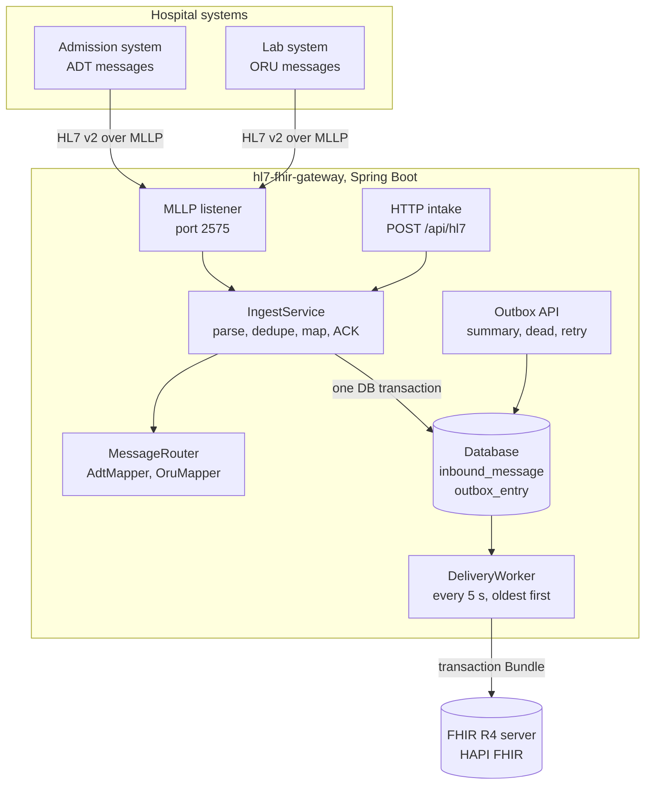
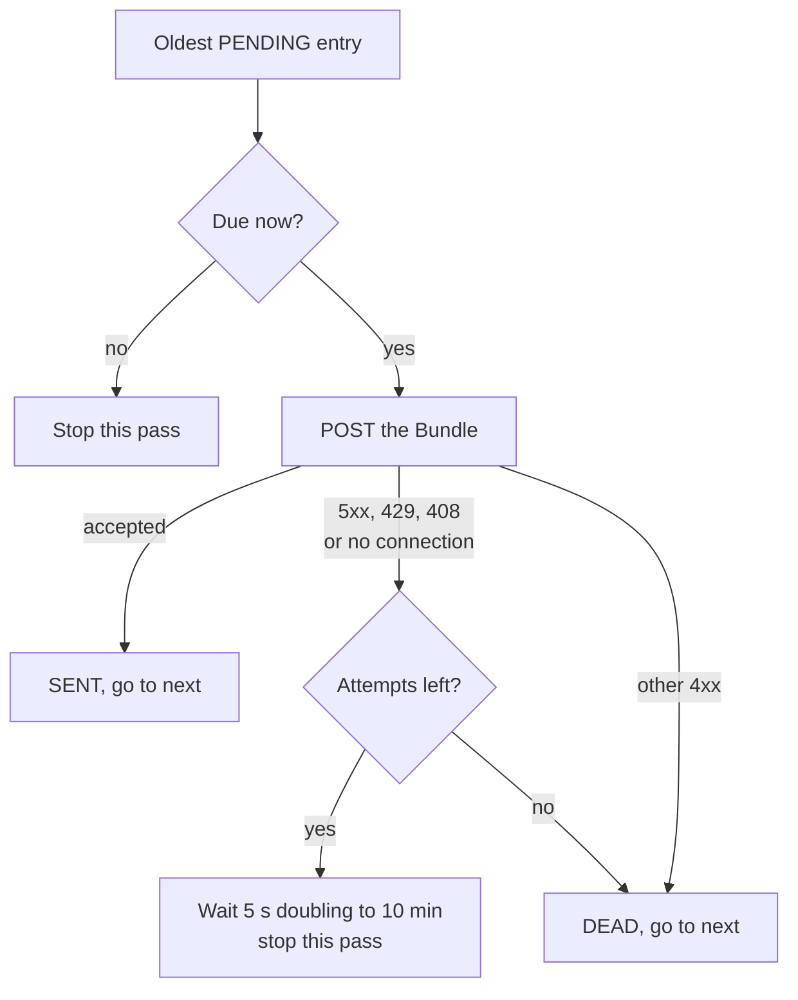

# hl7-fhir-gateway, explained

This is a plain-language guide to what hl7-fhir-gateway is, why it exists and how it is built. You do not need a background in healthcare or software to follow it. Technical terms are explained the first time they appear, and every term is in the [glossary](#glossary) at the end. For a longer explanation of the health IT standards mentioned here, see the [Health IT primer](https://github.com/Henrycarto/passayge/blob/main/docs/HEALTH_IT_PRIMER.md).

## In one sentence

hl7-fhir-gateway is a small server that takes the old-style text messages hospital systems send each other about admissions, discharges and lab results, and writes them safely into a modern FHIR health data server, without losing, duplicating or reordering anything.

## In one paragraph

Inside a hospital, the admission system, the lab system and the clinical record talk to each other with HL7 v2 messages: short text messages, one line per topic, fields separated by the `|` character. Newer applications expect FHIR instead, a web standard where data is stored as small structured records such as Patient, Encounter (a hospital stay) and Observation (one lab value). This gateway sits between the two. It receives HL7 v2 messages over MLLP (the simple network framing hospitals use for HL7 v2) or over a normal web request, answers the sender at once with an acknowledgement, stores the message and its FHIR translation in a database, and then delivers the translation to a FHIR server in the background. It is built around what goes wrong in real hospital interfaces: senders resend messages, the FHIR server goes down, messages must stay in order, and some messages are simply wrong. It matters because almost every hospital that adopts FHIR still has to feed it from HL7 v2, and the hard part of that job is not the translation but the failure handling.

## The real-world problem

### A short story

Margarete Huber is 68 and lives in Vienna. (She is fictional, like every patient in this project's sample messages.) On 20 October 2026 at 14:25 she is admitted to ward `INT`, room 204, bed B. The hospital's admission system sends an admission message. An hour later the lab finishes her blood count and sends the results: haemoglobin and platelets are normal, white cells (11.8) and glucose (104) are flagged high. On 24 October at 10:00 she is discharged, and the admission system sends a discharge message.

A new FHIR-based application, say a ward dashboard, should show Margarete as one patient, with one hospital stay that is first "in progress" and then "finished", and four lab values. Several things can get in the way:

1. **The admission message arrives twice.** The interface engine (the hospital's message router) did not get an answer fast enough and resent it. Is Margarete now two patients?
2. **The FHIR server is down for maintenance** when the lab results arrive. Are they lost? Does the lab system wait and block?
3. **The discharge is processed before the admission.** Is her stay now "in progress" again, as if she had never left?
4. **The lab message carries only her name and number, not her address.** Does it wipe the address that came with the admission?
5. **A message of a type the gateway does not handle arrives**, for example a patient merge. Is it silently dropped?

### What goes wrong

- **Senders resend.** Interface engines retry on timeout. Without care, every resend creates a second patient or a second set of results.
- **Servers go down.** If the sender has to wait until the FHIR server has stored the data, an outage on the FHIR side becomes an outage for the whole hospital feed.
- **Order matters.** A discharge applied before its admission leaves the stay in the wrong state.
- **Messages carry different amounts of data.** A lab message often has a thin patient segment; treating it as the full truth overwrites better data.
- **Some messages are wrong.** They need a clear rejection, and failures on the FHIR side need a place where an engineer can see them and resend them.

hl7-fhir-gateway answers each of these: it deduplicates on the sender and the message's own ID, answers the sender before talking to FHIR, delivers strictly oldest first and stops when the server is down, uses "create only if missing" for the patient in lab messages, and parks rejected deliveries in a dead-letter list with an endpoint to retry them.

## The healthcare background you need

Short definitions follow. The [Health IT primer](https://github.com/Henrycarto/passayge/blob/main/docs/HEALTH_IT_PRIMER.md) explains each one in more depth.

**HL7 v2.** The oldest and still the most common message format inside hospitals, published by HL7 International. A message is a set of lines called segments, each starting with a three-letter name: `MSH` (message header), `PID` (patient identification), `PV1` (patient visit), `OBR` (an order) and `OBX` (one observation, such as a lab value). Fields are numbered, so `PID-3` is the patient identifier and `MSH-10` is the message's own ID. It is like a paper form with numbered boxes: everyone agrees what goes in box 3, but people still fill the boxes in slightly differently.

**Message types and trigger events.** The type in `MSH-9` says what happened. `ADT` messages (admission, discharge, transfer) report patient movements: `A01` admit, `A03` discharge, `A04` register an outpatient, `A08` update patient details. `ORU^R01` carries observation results such as lab values. Think of the subject line of an email: it tells the receiver which kind of letter this is before they read it.

**ACK (acknowledgement).** The receiver's answer to every HL7 v2 message. Its `MSA-1` field holds a code: `AA` (accepted), `AE` (application error: the content is incomplete) or `AR` (rejected: wrong type or unreadable). `MSA-2` repeats the ID of the message being answered. It is the signed delivery slip a courier brings back.

**MLLP (Minimal Lower Layer Protocol).** How HL7 v2 messages travel over a plain network connection. Each message is wrapped between a start byte (`0x0B`) and two end bytes (`0x1C 0x0D`), so the receiver knows where one message ends and the next begins. MLLP adds no encryption and no login, which is why it normally runs inside a protected hospital network. It is an envelope with a clear "start" and "end" mark, but no lock.

**Interface engine.** The hospital's central message router, which takes messages from one system and forwards them to others. It retries when it does not get an ACK in time, which is why the same message can arrive twice. Think of a post office that sends a second copy if it does not get a receipt back.

**FHIR (Fast Healthcare Interoperability Resources).** HL7's modern standard for exchanging health data with ordinary web requests. Data is split into resources, small JSON documents with a fixed shape, such as `Patient`, `Encounter` (one visit or hospital stay) and `Observation` (one measurement). This project uses FHIR R4 (release 4). Think of standard shipping containers: any port can handle them because the shape is agreed in advance.

**Transaction Bundle.** A FHIR resource that carries several write requests together and asks the server to apply all of them or none. The gateway turns each HL7 v2 message into exactly one transaction Bundle. It is like a moving box with a packing list: either the whole box is delivered or it comes back unopened.

**Business identifier, MRN and visit number.** Hospitals identify a patient by an MRN (medical record number, here in `PID-3`) and a stay by a visit number (`PV1-19`). These numbers are the hospital's own, unlike the internal ID a FHIR server assigns when it stores something. The gateway writes everything keyed by these business numbers. It is the difference between your passport number and the cloakroom ticket a theatre gives you.

**Conditional update and conditional create.** Two kinds of FHIR write. A conditional update (`PUT Patient?identifier=...`) means "find the record with this identifier and replace it, or create it if there is none". A conditional create (`POST` with `ifNoneExist`) means "create it only if nothing with this identifier exists, otherwise leave it alone". Like "update the contact called Margarete Huber" versus "add Margarete Huber if she is not in my phone yet".

**LOINC and UCUM.** LOINC is a catalogue of codes for lab tests, so haemoglobin is `718-7` everywhere. UCUM is the standard for writing units of measure, such as `g/dL`. They are the shared vocabulary that lets one hospital's results be read by another's software.

**HAPI.** Two open-source Java libraries from the same project: HAPI HL7v2 reads and writes HL7 v2 messages and provides an MLLP server and client; HAPI FHIR provides the FHIR data model, a FHIR client and a complete FHIR server. This project uses the libraries inside the gateway and runs the HAPI FHIR server in Docker as the delivery target.

**Idempotency, outbox and dead-letter queue.** Three engineering patterns, explained in the primer. An operation is idempotent if doing it twice has the same effect as doing it once, like pressing a lift button five times. An outbox stores an outgoing message in the same database transaction as the change that caused it, and a worker sends it later, like a post tray on your desk. A dead-letter queue is where messages go that cannot be delivered, so a person can look at them, like the post office's undeliverable mail department.

## What it does, step by step

Here is one full journey, following the sample messages in [`samples/`](../samples) and the order of the demo script [`scripts/demo.sh`](../scripts/demo.sh). The gateway listens for HTTP on port 8080 and for MLLP on port 2575; the FHIR server runs on port 8090 (`docker-compose.yml`, `src/main/resources/application.yml`).

1. **The admission arrives.** The admission system sends `ADT^A01` with control ID `MSG00001` (from sending application `PAS`, facility `WIEN_KH`). Over MLLP, HAPI's server reads the frame and parses the message; over HTTP (`POST /api/hl7`), the gateway first cleans up what real senders send (line feeds instead of carriage returns, stray framing bytes, blank lines) and then parses it.
2. **Has this been seen before?** The gateway reads `MSH-3` (sending application), `MSH-4` (sending facility) and `MSH-10` (control ID) and checks the database. It is new.
3. **Translate.** The message is routed to the ADT mapper. It produces one transaction Bundle with two entries: a conditional update of the Patient by MRN `4711` (name, birth date, gender, address) and a conditional update of the Encounter by visit number `V0001`, with status `in-progress`, class "inpatient", start time 14:25 Vienna time and location `INT / 204 / B`.
4. **Store and answer.** In one database transaction, the raw message goes into the `inbound_message` table and the Bundle into the `outbox_entry` table with status `PENDING`. Only then does the sender get its ACK: `MSA|AA|MSG00001`. Over HTTP the status is 200 and the headers say `X-HL7-Ack-Code: AA` and `X-HL7-Duplicate: false`. `AA` here means "stored and queued", not "written to FHIR".
5. **The lab result arrives.** `ORU^R01` with four `OBX` lines. The ORU mapper makes a Bundle with a conditional create of the Patient (only if MRN `4711` does not exist yet) and four Observations, each with a LOINC code, a value with its unit, the reference range text, the high or normal flag and the time. Each Observation gets a stable identifier, for haemoglobin `WIEN_KH|LAB98765|1|718-7` (facility, lab order number, line number, test code), and is written as a conditional update by that identifier.
6. **The admission arrives again.** The interface engine resends `MSG00001`. The database already has that sender and control ID, so the gateway answers `AA` again, with `X-HL7-Duplicate: true`, and queues nothing.
7. **An unsupported message arrives.** `ADT^A40` (patient merge) has no mapper, so the gateway answers `AR` (HTTP 400) and stores nothing. A message of a supported type that lacks required data, for example no `PID-3`, gets `AE` (HTTP 422) and is also not stored, so the sender can fix it and resend with the same control ID.
8. **Delivery.** Every 5 seconds the delivery worker reads up to 50 `PENDING` entries, oldest first, and posts each Bundle to the FHIR server. On success the entry becomes `SENT`. The FHIR server now holds one Patient, one Encounter and four Observations.
9. **The FHIR server goes down** (suppose). The worker gets "connection refused" or a 5xx error, marks the entry for another try in 5 seconds, and stops the pass so nothing overtakes it. Each further failure doubles the wait, up to 10 minutes. When the server is back, delivery resumes in the original order.
10. **The discharge arrives.** `ADT^A03` for the same visit number. Its Bundle replaces the same Encounter, now `finished` with an end time of 24 October, 10:00.
11. **If the FHIR server rejects a Bundle** (for example a 400 or 422 answer), the entry goes straight to `DEAD` with the server's error stored, and the queue moves on. An engineer sees it at `GET /api/outbox/dead`, fixes the cause and calls `POST /api/outbox/{id}/retry` to put it back in the queue. `GET /api/outbox/summary` shows the counts of pending, sent and dead entries.

## How it is built

What the delivery worker does with the entry at the head of the queue:

### The parts

All Java files are under `src/main/java/io/github/henrycarto/gateway/`.

| Part | What it is | Why it exists | Talks to |
|---|---|---|---|
| **MLLP listener** ([`mllp/MllpServer.java`](../src/main/java/io/github/henrycarto/gateway/mllp/MllpServer.java), [`mllp/Hl7ReceivingApplication.java`](../src/main/java/io/github/henrycarto/gateway/mllp/Hl7ReceivingApplication.java)) | A HAPI HL7v2 server on port 2575, started and stopped with the application. It accepts every message type and hands each message to the ingest service. | Hospital interface engines send HL7 v2 over MLLP. | Senders over TCP; `IngestService`. |
| **HTTP intake** ([`api/Hl7Controller.java`](../src/main/java/io/github/henrycarto/gateway/api/Hl7Controller.java)) | `POST /api/hl7`, accepting `text/plain`, `application/hl7-v2` and `x-application/hl7-v2+er7`. The body of the answer is always an HL7 ACK; the HTTP status mirrors it (AA 200, AE 422, AR 400). | For systems that cannot speak MLLP, and for testing with `curl`. | `IngestService`. |
| **Parser** ([`hl7/Hl7Parser.java`](../src/main/java/io/github/henrycarto/gateway/hl7/Hl7Parser.java), [`hl7/MessageHeader.java`](../src/main/java/io/github/henrycarto/gateway/hl7/MessageHeader.java), [`config/BeansConfig.java`](../src/main/java/io/github/henrycarto/gateway/config/BeansConfig.java)) | Cleans up line endings and framing bytes, then parses with HAPI. Every message is read into the v2.5 model, with field validation switched off. `MessageHeader` pulls out the five header fields the gateway routes and deduplicates on. | One structure for the mappers; tolerance for senders that are not strict. | HAPI HL7v2. |
| **Ingest service** ([`ingest/IngestService.java`](../src/main/java/io/github/henrycarto/gateway/ingest/IngestService.java)) | The only path into the system, shared by HTTP and MLLP: duplicate check, mapping, storing, ACK. Builds an `AR` by hand for input HAPI cannot parse, echoing `MSH-10` if it can find it. | One place for the rules about what is accepted. | Router, both tables, HAPI. |
| **Inbound messages** ([`ingest/InboundMessage.java`](../src/main/java/io/github/henrycarto/gateway/ingest/InboundMessage.java)) | Every accepted message, kept as text, with a unique constraint on sending application, sending facility and control ID. | The record of what was accepted, and the guard against resends. | The database. |
| **Router and mappers** ([`mapping/MessageRouter.java`](../src/main/java/io/github/henrycarto/gateway/mapping/MessageRouter.java), [`AdtMapper.java`](../src/main/java/io/github/henrycarto/gateway/mapping/AdtMapper.java), [`OruMapper.java`](../src/main/java/io/github/henrycarto/gateway/mapping/OruMapper.java), [`PatientMapper.java`](../src/main/java/io/github/henrycarto/gateway/mapping/PatientMapper.java)) | The router asks each mapper whether it supports the message type. The ADT mapper handles A01, A03, A04 and A08; the ORU mapper handles R01; both use the patient mapper for `PID`. | Adding a message type means adding one class. | `TransactionBuilder`. |
| **Transaction builder** ([`mapping/TransactionBuilder.java`](../src/main/java/io/github/henrycarto/gateway/mapping/TransactionBuilder.java)) | Builds the FHIR transaction Bundle. `upsert()` adds a conditional update by identifier; `ensureExists()` adds a conditional create. Each entry's temporary ID is a UUID computed from type, system and value, so the same input always gives the same Bundle. | Replays give the same end state on the server. | Mappers. |
| **Timestamps** ([`hl7/Hl7Dates.java`](../src/main/java/io/github/henrycarto/gateway/hl7/Hl7Dates.java)) | Converts HL7 timestamps (from `YYYY` up to fractions of a second, with or without an offset like `+0200`) into FHIR dates, keeping the precision the sender gave. A timestamp without an offset is read in `Europe/Vienna` by default. | Wrong time zones put lab results at the wrong hour. | Mappers. |
| **Outbox** ([`outbox/OutboxEntry.java`](../src/main/java/io/github/henrycarto/gateway/outbox/OutboxEntry.java), [`OutboxRepository.java`](../src/main/java/io/github/henrycarto/gateway/outbox/OutboxRepository.java), [`OutboxStatus.java`](../src/main/java/io/github/henrycarto/gateway/outbox/OutboxStatus.java)) | One row per Bundle to deliver: status `PENDING`, `SENT` or `DEAD`, number of attempts, time of the next attempt, last error (up to 4,000 characters). | Nothing is lost while the FHIR server is unavailable. | Ingest service writes it; worker and outbox API read it. |
| **Delivery worker** ([`outbox/DeliveryWorker.java`](../src/main/java/io/github/henrycarto/gateway/outbox/DeliveryWorker.java), [`BackoffPolicy.java`](../src/main/java/io/github/henrycarto/gateway/outbox/BackoffPolicy.java)) | A scheduled job (every 5 s by default) that delivers in arrival order, waits with exponential backoff on outages and stops at the head of the queue, and moves rejected entries to `DEAD`. | Order and reliability. | Outbox, `FhirSender`. |
| **FHIR sender** ([`outbox/FhirSender.java`](../src/main/java/io/github/henrycarto/gateway/outbox/FhirSender.java), [`HapiFhirSender.java`](../src/main/java/io/github/henrycarto/gateway/outbox/HapiFhirSender.java), [`FhirDeliveryException.java`](../src/main/java/io/github/henrycarto/gateway/outbox/FhirDeliveryException.java)) | Posts one Bundle with the HAPI FHIR client and sorts failures into retryable (no connection, 5xx, 429, 408) and not retryable (other 4xx, or a stored Bundle that is not valid JSON). | The interface is a seam: tests replace it with a scripted fake. | The FHIR server. |
| **Outbox API** ([`api/OutboxController.java`](../src/main/java/io/github/henrycarto/gateway/api/OutboxController.java)) | `GET /api/outbox/summary`, `GET /api/outbox/dead` (last 100 dead entries with the server's error), `POST /api/outbox/{id}/retry`. | What an engineer on call needs: how much is stuck, why, and a way to replay it. | Outbox. |
| **Configuration** ([`config/GatewayProperties.java`](../src/main/java/io/github/henrycarto/gateway/config/GatewayProperties.java), [`application.yml`](../src/main/resources/application.yml)) | FHIR base URL, identifier systems (placeholders under `https://example.org/`), default time zone, MLLP port, retry policy. H2 file database by default; a `postgres` profile switches to PostgreSQL. | Everything that differs between hospitals lives in configuration, not code. | Every part. |
| **FHIR server** ([`docker-compose.yml`](../docker-compose.yml)) | `hapiproject/hapi:v7.4.0`, published on port 8090. | A real target for local runs and the demo. | Receives Bundles from the worker. |

## The technology stack

Versions are from [`pom.xml`](../pom.xml) and the resolved Maven dependency list.

| Item | Version | What it does here | Why this one |
|---|---|---|---|
| Java | 21 | The language and runtime. | Required in `pom.xml` and by CI (Temurin 21). The code uses records and switch expressions, which need a recent Java. Why 21 over 17 is not recorded: not confirmed. |
| Spring Boot | 3.3.5 | Application framework: web server, scheduling, configuration, database access, health endpoint. | Not recorded in the repo: not confirmed. A reasonable reading: it is the default choice for Java services in hospitals and vendors, and gives the scheduler, transactions and configuration binding the gateway needs. |
| Spring Web (embedded Tomcat) | Tomcat 10.1.31 | Serves `/api/hl7`, `/api/outbox/*` and `/actuator/health`. | Comes with Spring Boot. |
| Spring Data JPA with Hibernate | Hibernate 6.5.3.Final | Stores inbound messages and outbox entries. | Not confirmed. Gives the unique constraint and the `findTop50ByStatusOrderByIdAsc` query with almost no code. |
| Spring Boot Actuator | 3.3.5 | `GET /actuator/health` and `/actuator/info`. | Liveness check (README). |
| Bean Validation | 3.3.5 starter | Checks the configuration at start-up (for example a blank FHIR URL fails). | `@Validated` on `GatewayProperties`. |
| HAPI HL7v2 (`hapi-base`, `hapi-structures-v25`) | 2.5.1 | Parses HL7 v2, builds ACKs, runs the MLLP server; the tests also use its MLLP client. | Not recorded: not confirmed. It is the established open-source Java HL7 v2 library and includes MLLP, so no separate network code was needed. |
| HAPI FHIR (`hapi-fhir-structures-r4`, `hapi-fhir-client`) | 7.4.0 | FHIR R4 data model, JSON parser and REST client. | Not recorded: not confirmed. Same project as the HL7v2 library and as the FHIR server used in tests. |
| H2 | 2.2.224 | Default database, a file in `./data/`; in-memory in tests. | Nothing to install. |
| PostgreSQL JDBC driver | 42.7.4 | Used with the `postgres` profile and `DATABASE_URL`. | For a production-like database. Not tested in the repo. |
| HAPI FHIR JPA server (Docker image) | `hapiproject/hapi:v7.4.0` | The FHIR server for local runs, the demo and the integration test. | Matches the HAPI FHIR library version. Why HAPI over another FHIR server is not recorded: not confirmed. |
| JUnit 5, AssertJ, Spring Boot Test, MockMvc | JUnit 5.10.5, AssertJ 3.25.3 | Unit and Spring tests. | Spring Boot defaults. |
| Testcontainers | 1.21.4 | Starts the HAPI FHIR image in Docker for the integration test. | The test runs against a real server and cleans up after itself. |
| Maven | no wrapper in the repo; 3.9.9 used for the run below | Build and tests; profile `integration` runs the Docker test. | Not confirmed. |
| Docker Compose | n/a | Starts the local FHIR server (`docker-compose.yml`). | One command. |
| GitHub Actions | `actions/checkout@v4`, `actions/setup-java@v4` | CI: one job, `build`, with unit and integration tests. | Runs on every push to `main` and every pull request. |
| GitHub Codespaces dev container | image `mcr.microsoft.com/devcontainers/java:1-21-bookworm` | A cloud workspace with Java 21, Maven and a HAPI FHIR server (`.devcontainer/`). | Lets a reviewer try it without installing anything (README). |
| VHS | n/a | Records `docs/demo.gif` from `docs/demo.tape`. | Scripted, repeatable terminal recording. |

## The hard parts and how they were solved

### 1. A resend must change nothing

**Problem.** Interface engines resend when an ACK is late. The same admission arriving twice must not create two patients, two stays or two sets of lab values. And two copies can arrive at almost the same moment.

**Solution.** Two layers. First, the database has a unique constraint on sending application, sending facility and control ID (`MSH-3`, `MSH-4`, `MSH-10`). A message already seen is answered `AA` and nothing new is queued. If two copies race past the check at the same time, the database refuses the second insert and the gateway treats it as a duplicate too. Second, even if the same content reaches the FHIR server twice (for example after an operator retry), every write is keyed by a business identifier, never by a server ID: Patient by MRN, Encounter by visit number, Observation by a stable key. So the server ends up in the same state. Messages answered `AE` are not recorded, so a fixed message can reuse its control ID.

**Where.** [`ingest/InboundMessage.java`](../src/main/java/io/github/henrycarto/gateway/ingest/InboundMessage.java) (`uk_inbound_sender_control_id`), [`ingest/IngestService.java`](../src/main/java/io/github/henrycarto/gateway/ingest/IngestService.java) (the `DataIntegrityViolationException` branch), [`mapping/TransactionBuilder.java`](../src/main/java/io/github/henrycarto/gateway/mapping/TransactionBuilder.java). Tests: `resendOfSameControlIdIsAcknowledgedButNotQueuedTwice` and `rejectedMessageCanBeResentOnceFixed` in `IngestServiceTest`, `observationIdentifierIsStableAcrossReplays` in `OruMapperTest`, and the integration test, which sends admission, lab result and discharge twice each to a real HAPI server and finds exactly one Patient, one Encounter and four Observations.

### 2. A fast answer that does not depend on the FHIR server

**Problem.** If the sender only gets its ACK after the FHIR server has stored the data, every FHIR outage stops the hospital feed, and a crash between "stored" and "answered" loses or duplicates data.

**Solution.** The outbox pattern. The raw message and its Bundle are written in one database transaction, then the ACK goes out. `AA` therefore means "stored durably and queued", not "written to FHIR". A separate scheduled worker does the delivery. The sender never waits on the FHIR server.

**Where.** `IngestService.ingest()` (the `TransactionTemplate` block), [`outbox/OutboxEntry.java`](../src/main/java/io/github/henrycarto/gateway/outbox/OutboxEntry.java), [`outbox/DeliveryWorker.java`](../src/main/java/io/github/henrycarto/gateway/outbox/DeliveryWorker.java). Tests: `acceptedMessageIsStoredAndQueued` in `IngestServiceTest`; `mllpClientGetsAnAckAndMessageIsQueued` in `MllpServerTest`, where the MLLP client gets `AA` and an outbox entry appears without any call to the FHIR server (in the test profile the FHIR URL points at `http://localhost:1/fhir` and the scheduled worker is held back for an hour).

### 3. Keep order without letting one bad message block everything

**Problem.** A discharge applied before its admission leaves the stay in the wrong state, so later messages must not overtake earlier ones. But if a message is rejected by the FHIR server because of its content, retrying it forever would block every message behind it.

**Solution.** The worker reads pending entries strictly oldest first. On a retryable failure (no connection, timeout, 5xx, 429, 408) it schedules the next try with exponential backoff, 5 s doubling to a 10-minute cap, and stops the pass, so nothing behind it moves. On a non-retryable failure (other 4xx) the entry goes to `DEAD` with the server's OperationOutcome stored, and the queue moves on. After `max-attempts` (12 by default) retryable failures the entry also goes to `DEAD`. An operator can list dead entries and requeue one after fixing the cause.

**Where.** [`outbox/DeliveryWorker.java`](../src/main/java/io/github/henrycarto/gateway/outbox/DeliveryWorker.java), [`outbox/BackoffPolicy.java`](../src/main/java/io/github/henrycarto/gateway/outbox/BackoffPolicy.java), [`outbox/HapiFhirSender.java`](../src/main/java/io/github/henrycarto/gateway/outbox/HapiFhirSender.java), [`api/OutboxController.java`](../src/main/java/io/github/henrycarto/gateway/api/OutboxController.java). Tests: `retryableFailureBlocksLaterMessagesToKeepOrder` ("the discharge was never tried ahead of the admit"), `contentRejectionGoesStraightToDeadLetterAndQueueMovesOn`, `serverErrorIsRetriedAfterBackoff`, `givesUpAfterMaxAttempts` in `DeliveryWorkerTest`; `doublesUntilCapped` in `BackoffPolicyTest`; `deadLetterCanBeInspectedAndRequeued` in `ApiTest`.

### 4. A lab message must not overwrite the admission data

**Problem.** A lab message's `PID` segment is often thin: name and number, no address. If the gateway replaced the Patient with it, the address from the admission would disappear. And a corrected lab value must replace the original, not sit next to it.

**Solution.** In ORU messages the Patient is written with a conditional create (`POST` with `ifNoneExist`): created if the MRN is unknown, left untouched otherwise. Admission messages, which carry full demographics, use a conditional update. Each Observation's identifier is built from facility, lab order number (or control ID and order position when there is none), `OBX` line number and test code. That key does not include the result status, so a corrected result (`OBX-11` = `C`, mapped to FHIR status `corrected`) with the same key replaces the original. The A08 update message only touches the Patient, so it cannot reset the stay's status.

**Where.** `TransactionBuilder.ensureExists()`, [`mapping/OruMapper.java`](../src/main/java/io/github/henrycarto/gateway/mapping/OruMapper.java), [`mapping/AdtMapper.java`](../src/main/java/io/github/henrycarto/gateway/mapping/AdtMapper.java). Tests: `patientIsCreatedOnlyIfMissing` in `OruMapperTest`, `updateTouchesPatientOnly` in `AdtMapperTest`, and the integration test, which checks that the Patient still has its address after the lab message. A full correction scenario (same result sent first as final, then as corrected) is not tested.

### 5. Timestamps with any precision and no time zone

**Problem.** HL7 v2 timestamps can be just a year, a date, a date with hours and minutes, or a full time with fractions of a second, and often have no time zone offset. FHIR wants an exact format: a date with a time must include seconds and a zone.

**Solution.** `Hl7Dates` reads the timestamp with one pattern, keeps date-only values as dates, fills missing minutes and seconds with zero, and keeps milliseconds when they were sent. A timestamp without an offset is read in the configured zone, `Europe/Vienna` by default, including summer time. Anything that is not a timestamp is refused, which leads to an `AE`.

**Where.** [`hl7/Hl7Dates.java`](../src/main/java/io/github/henrycarto/gateway/hl7/Hl7Dates.java). Tests in `Hl7DatesTest`: `noOffsetUsesDefaultZoneIncludingDaylightSaving` (14:30 on 20 October is 12:30 UTC, 14:30 on 20 December is 13:30 UTC), `dateOnlyKeepsDayPrecision`, `fractionalSecondsGiveMilliPrecision`, `explicitOffsetWins`, `blankIsNullAndGarbageIsRejected`.

## How we know it works

Counts below are from running both suites locally on 24 October 2026, at commit `f4907b5`, with Temurin JDK 21.0.12 and Maven 3.9.9. All passed.

| Suite | Command | Tests | What it proves |
|---|---|---|---|
| Unit and Spring tests | `mvn -B test` | 34 passed, 0 failed, 0 skipped (22 s) | See the breakdown below. No Docker needed; the FHIR server is replaced by a scripted fake and the clock by one the tests move forward. |
| Integration test | `mvn -B verify -Pintegration` | 1 passed, 0 failed, 0 skipped | Starts `hapiproject/hapi:v7.4.0` with Testcontainers (it took 59.5 s to start; the test took 69.3 s in total), maps A01, ORU and A03 and sends each Bundle twice with the real `HapiFhirSender`, then finds one Patient, one finished Encounter and four Observations, with the Patient's address intact. It calls the mappers and the sender directly, so it tests FHIR-side idempotency, not the database duplicate check or the outbox. |

The 34 tests by class:

| Test class | Tests | What it covers |
|---|---|---|
| `IngestServiceTest` | 7 | Stored and queued; resend not queued twice; unsupported type gets `AR`; missing `PID-3` gets `AE` and stores nothing; a fixed message can reuse its control ID; garbage gets a hand-built `AR`; CRLF line endings accepted. |
| `OruMapperTest` | 7 | Patient by conditional create; one Observation per `OBX`; numeric values as UCUM quantities with range and flag; time from `OBX-14`, falling back to `OBR-7`; stable identifiers; `<0.5` kept as text; result status mapping. |
| `AdtMapperTest` | 5 | Admission makes Patient and in-progress inpatient Encounter, field by field; discharge finishes the same Encounter; A08 touches Patient only; missing `PID-3` is a mapping error; patient class mapping. |
| `Hl7DatesTest` | 5 | Offsets, the Vienna default with summer time, date-only precision, milliseconds, rejection of non-timestamps. |
| `DeliveryWorkerTest` | 5 | Delivery; retry after backoff; rejection goes to `DEAD` and the queue moves on; a retryable failure blocks later messages; give up after max attempts. |
| `ApiTest` | 3 | HTTP status mirrors the ACK code; dead entries can be listed and requeued; retry of an unknown ID is 404. |
| `MllpServerTest` | 1 | A real TCP socket with MLLP framing, using HAPI's client: the answer is `AA` with the right `MSA-2`, and one outbox entry is added. |
| `BackoffPolicyTest` | 1 | 5, 10, 80 seconds, then capped at 600. |

**Continuous integration** ([`.github/workflows/ci.yml`](../.github/workflows/ci.yml)) has one job, **build**, on every push to `main` and every pull request, with two test steps: "Unit and Spring tests" (`mvn -B test`) and "Integration tests against HAPI FHIR" (`mvn -B verify -Pintegration`). The latest run (21 October 2026, commit `f4907b5`, 1 min 26 s) succeeded; its log shows the same 34 tests and 1 integration test passing.

**Validation against an official tool.** None. The repo does not run the FHIR validator or check the Bundles against any profile. The integration test proves that a real HAPI FHIR server accepts the transaction Bundles and stores the expected resources, which is a weaker claim than conformance.

## What is deliberately simplified or left out

| Simplification | Why |
|---|---|
| One gateway process only. The worker is not safe to run in several instances at once. | README: running several would need row locking (`SELECT ... FOR UPDATE SKIP LOCKED`) or a message broker. |
| One global queue. A single stuck message delays every patient. | README: per-patient queues would fix that at the cost of more complexity. |
| Lab results become Observations only, with no DiagnosticReport grouping them per order. | README: named as the obvious next step. |
| No patient merges: `ADT^A40` is rejected with `AR`. | README: merges need FHIR `$merge` or link handling, which differs between servers. |
| No authentication on the HTTP endpoints, the MLLP port or the FHIR client. | README: in a hospital this runs inside the integration network; mTLS or SMART backend services auth would be added to the client. |
| Only ADT A01, A03, A04, A08 and ORU R01. No transfers (A02), cancellations (A11, A13) or orders. | Scope. A04 is treated like A01 (Encounter in progress); its patient class decides inpatient or outpatient. |
| Every message is read into the v2.5 model with field validation off. | `BeansConfig`: senders are not strict, and the mappers check the fields they need. The README says messages from v2.3 to v2.5.1 are read into the v2.5 model and "anything else gets an `AR` ACK". The code has no explicit version check and no test uses another version, so whether a message in another version is rejected is not confirmed by the code or tests. |
| Identifier systems are placeholders under `https://example.org/`. | Configuration: replace with the hospital's own systems. |
| No national profile, such as HL7 Austria AT Core, and no profile validation. | Not stated in the repo; the target is plain FHIR R4. |
| Units from `OBX-6` are labelled as UCUM without checking them; non-LOINC codes go into one configurable local code system; abnormal flags are copied as codes. | Not stated in the repo; a reasonable reading is that a real deployment would add a terminology mapping. |
| The attending doctor in `PV1-7` and the ordering details in `OBR` are not mapped; the location is a text label (`INT / 204 / B`), not a Location resource. | Not stated in the repo. |
| The database schema is created by Hibernate (`ddl-auto: update`), with no migration tool. | Not stated in the repo. |
| PostgreSQL support is configuration only; all tests use H2. | Not stated in the repo. |
| All sample patients are fictional. | README. |

Also worth knowing:

- An entry that runs out of retries goes to `DEAD` and the worker then continues with the next entry in the same pass. So once something is dead, later messages for the same patient are delivered without it; ordering is kept while retrying, not after giving up.
- For messages received over MLLP, the stored raw text is HAPI's re-encoding of the parsed message, not the exact bytes received. Over HTTP it is the cleaned-up input.
- A requeued dead entry keeps its last error text until it is delivered.

## Glossary

**ACK (acknowledgement).** The HL7 v2 answer to a message. `MSA-1` holds `AA`, `AE` or `AR`; `MSA-2` repeats the original control ID.

**AA, AE, AR.** Application Accept, Application Error, Application Reject. In this gateway: stored and queued; supported type but missing data; unsupported type or unreadable.

**ADT (admission, discharge, transfer).** The HL7 v2 message family for patient movements, for example `ADT^A01` admit.

**Backoff, exponential.** Waiting longer after each failure: here 5 s, 10 s, 20 s and so on, capped at 10 minutes.

**Bundle.** A FHIR resource that carries several resources or requests together. A transaction Bundle is applied all or nothing.

**Business identifier.** A number the hospital assigns, such as an MRN or visit number, as opposed to a server's internal ID.

**CI (continuous integration).** Automated checks that run on every change to the code, here on GitHub Actions.

**Conditional create.** A FHIR write that creates a resource only if none with the given identifier exists (`ifNoneExist`).

**Conditional update.** A FHIR write that replaces the resource found by an identifier, or creates it if none exists (`PUT Patient?identifier=...`).

**Control ID.** `MSH-10`, the sender's unique ID for one message.

**Dead letter (DEAD).** An outbox entry that will not be retried automatically, because the server rejected it or it ran out of attempts.

**Docker, Docker Compose.** Docker runs containers (packaged, isolated programs); Compose starts several from one file.

**Encounter.** The FHIR resource for one visit or hospital stay, with a status such as `in-progress` or `finished`.

**ER7.** The usual pipe-and-hat text encoding of HL7 v2 messages.

**FHIR (Fast Healthcare Interoperability Resources).** HL7's web standard for health data, made of resources exchanged over REST.

**FHIR R4.** Release 4 of FHIR, the version used here.

**H2.** A small Java database that runs inside the application, used here by default and in tests.

**HAPI FHIR.** Open-source Java libraries for FHIR and a complete FHIR server; the server runs here as the Docker image `hapiproject/hapi:v7.4.0`.

**HAPI HL7v2.** An open-source Java library for parsing HL7 v2 and running MLLP servers and clients.

**Head-of-line blocking.** When the first item in a queue cannot proceed, nothing behind it moves. Here it is on purpose, to keep order during an outage.

**HL7 (Health Level Seven International).** The standards organisation behind HL7 v2 and FHIR.

**HL7 v2.** The pipe-delimited message format used inside hospitals since the late 1980s.

**Idempotent.** Doing something twice has the same effect as doing it once.

**Integration test.** A test that runs against real external software, here a HAPI FHIR server in Docker.

**Interface engine.** A hospital's central message router between systems.

**JSON.** A simple text format for structured data, used by FHIR.

**LOINC.** A catalogue of codes for lab tests, for example `718-7` haemoglobin.

**MLLP (Minimal Lower Layer Protocol).** The framing for HL7 v2 over TCP: a start byte and two end bytes around each message.

**MRN (medical record number).** The hospital's patient number, here from `PID-3`.

**MSH, PID, PV1, OBR, OBX, MSA.** HL7 v2 segments: message header, patient identification, patient visit, observation request (order), observation result, message acknowledgement.

**Observation.** The FHIR resource for one measurement, such as a lab value.

**OperationOutcome.** The FHIR resource a server returns to explain an error.

**ORU (observation result, unsolicited).** The HL7 v2 message type for results, here `ORU^R01` lab results.

**Outbox.** A table of messages waiting to be sent, written in the same transaction as the change that caused them.

**Patient.** The FHIR resource for a person receiving care.

**PostgreSQL.** An open-source database server, supported here through a configuration profile.

**Resource.** One unit of FHIR data, such as Patient or Observation.

**REST.** A style of web interface where data is read and written with standard web requests on addresses.

**Segment.** One line of an HL7 v2 message, starting with a three-letter name.

**Spring Boot.** A Java framework for building server applications.

**Testcontainers.** A Java library that starts Docker containers for a test and removes them afterwards.

**Transaction (database).** A group of database writes that are stored together or not at all.

**Trigger event.** The second part of an HL7 v2 message type, for example `A01` in `ADT^A01`.

**UCUM.** The standard for writing units of measure, such as `g/dL`.

**Visit number.** The hospital's number for one stay, here from `PV1-19`.
